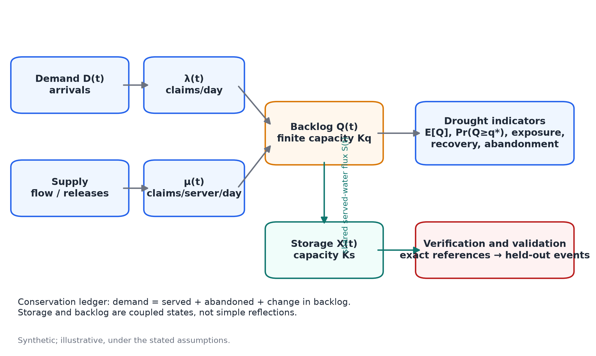
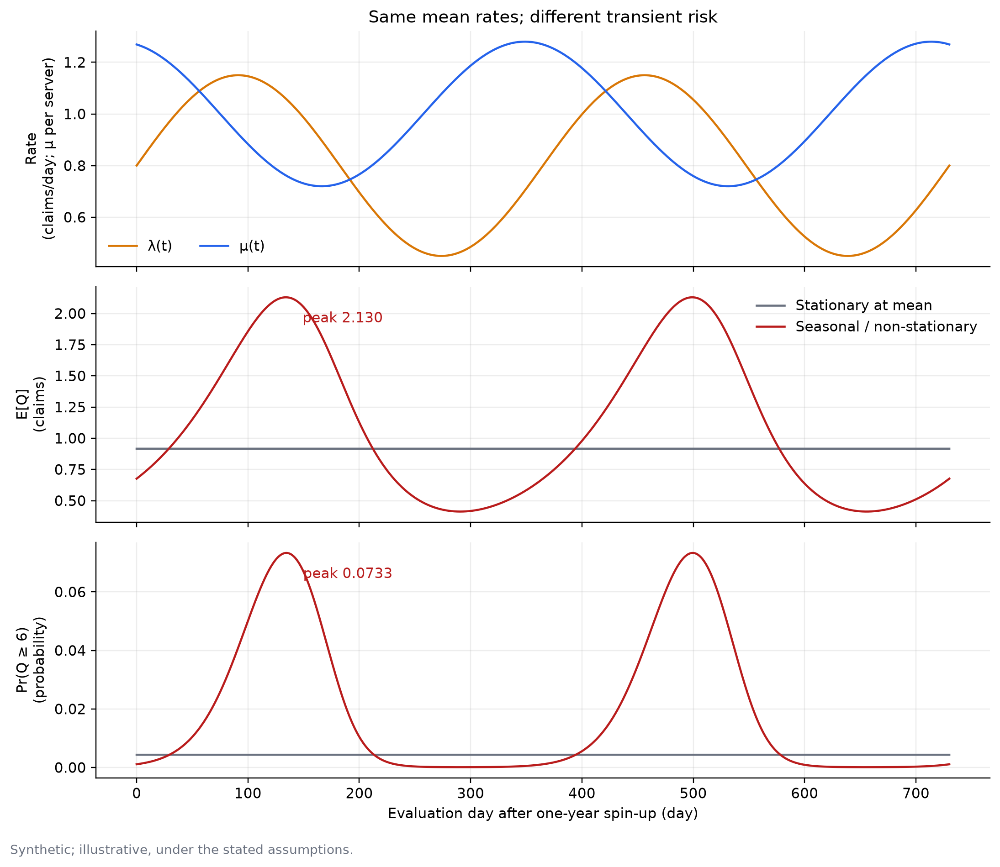
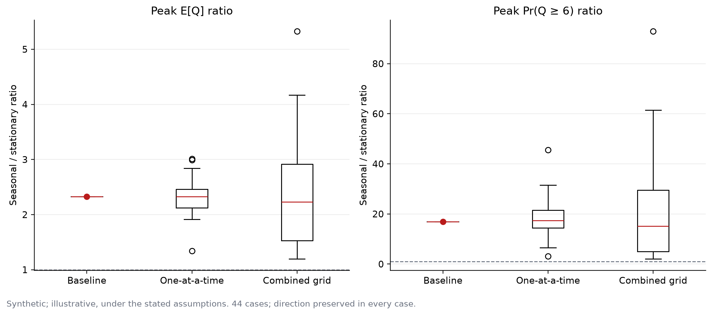

# P01 — Working draft v2 (25 November 2026 Phase-B revision)

> **Status.** The 21 November 2026 gap sentence is unchanged. This revision
> corrects the indicator contract and units, adds the demand-conservation
> ledger, updates the completed WoS/Scopus status, and incorporates prior art
> found in the 21 November citation trace and the 25 November supplementary
> search. Box 1 numbers are synthetic and **illustrative, under the stated
> assumptions** (`src/shared/queue_core.py`), not observational findings.
> The technical Gate B checklist passes (`GATE_B_CHECKLIST.md`); author
> sign-off on submission metadata and definitions remains pending.

---

## Dams, queues and droughts: reclaiming storage theory for deficit-accumulation drought science

**Ankit Deshmukh**
Department of Civil Engineering, Pandit Deendayal Energy University, Gandhinagar, India

### Abstract (draft)

Hydrological drought is conventionally diagnosed with standardized indices that locate anomalies relative to climatology. They describe when water is scarce but not how unmet demand accumulates, how long a deficit takes to clear, or whether shortage reflects demand pressure or constrained supply. Queueing theory addresses these mechanism-level questions and has a long hydrological lineage: Langbein's “Queuing Theory and Water Storage” appeared in 1958, Moran and Gani developed dam-storage theory, and Prabhu unified queues, insurance risk and dams. Hydrological applications include soil-water residence time, runoff, rainwater harvesting, irrigation and supply reliability.

This perspective reconnects that lineage to drought through two coupled representations: stored water as a buffer and unmet demand as a backlog, joined by the served-water flux and an explicit conservation ledger. The resulting quantities include backlog stock, backlog exposure, utilisation, waiting time, first-passage recovery and abandoned demand.

A controlled synthetic experiment shows that a time-varying queue with the same mean arrival and service rates as a stationary one can produce a 2.3-fold larger peak backlog and a 17-fold larger critical-state probability. These values are synthetic and **illustrative, under the stated assumptions**. The contribution is deliberately narrow: not stochastic storage theory, queueing in hydrology or time-varying queueing, but a drought-specific, conservation-constrained parameterisation of a non-stationary deficit queue, with explicit tests of demand–supply identifiability and incremental information under pre-specified validation.

---

## 1. Introduction

Drought is usually introduced as a hazard of *deficit*: precipitation below a
climatological norm, soil moisture below an expectation, streamflow below an
exceedance threshold. The index tradition — the Standardized Precipitation Index
(McKee et al., 1993), the Standardized Precipitation Evapotranspiration Index
(Vicente-Serrano et al., 2010), and their hydrological counterparts — made
drought comparable across places and time. It also fixed the intellectual frame:
a drought is an anomaly to be measured, and propagation is studied through lags
and correlations between anomaly series (van Loon, 2015).

That frame has a blind spot. Water scarcity becomes damaging not when an
anomaly is first detected but when **demand that cannot be met accumulates
faster than supply can clear it**. Two catchments with the same rainfall deficit
can diverge sharply: one has storage and reliable delivery, the other does not.
The difference is not an anomaly magnitude; it is a service-capacity constraint
and a backlog trajectory. Standardized indices do not represent that backlog,
do not give recovery time as a model output, and do not separate shortage caused
by unusually high demand pressure from shortage caused by degraded supply. They
can tell us that a drought is occurring; they cannot tell us how long the system
will need to dig itself out, or how much demand will be abandoned along the way.

Queueing theory is the mathematics of arrival streams, finite service capacity,
congestion and waiting. Its core objects — queue length, busy period, waiting
time, utilisation, loss probability — are the objects a drought manager is
implicitly asking for when they ask how severe a shortage is, when it will end,
and who will be cut off. The connection is not a metaphor imposed from outside,
and it has a long hydrological lineage. Langbein (1958) set out "Queuing Theory
and Water Storage" in this journal's predecessor, the *Journal of the Hydraulics Division*. In probability theory Moran (1954) and
Gani (1957, 1969) built the theory of dams as random storage systems; Prabhu
(1998) unified queues, insurance risk and dams as stochastic storage processes.
Hydrology also developed conceptual rainfall–runoff models, standardized
indices and distributed models. The queueing line survived in operations
research and in a small set of hydrological applications, discussed in
Section 2.3. The unresolved question addressed here is whether that machinery
can be operationalised for drought deficit accumulation with modern data,
non-stationary rates, explicit identification tests and interpretable risk
indicators.

This perspective makes four contributions. First, it states the mapping between
queueing mechanisms and drought processes precisely enough to be implemented,
including the awkward cases — abandonment, blocked demand, state-dependent
emergency supply — that a naive analogy would mishandle. Second, it separates
physical storage from unmet-demand backlog and links them through the
served-water flux and conservation equations; this shows which observations
constrain each state and when a demand-versus-supply attribution is
identifiable. Third, it demonstrates with a controlled synthetic experiment
why stationarity is not a harmless simplification for drought under climate
change. Fourth, it sets out a falsifiable research programme: if queue-derived
indicators cannot beat standard indices under pre-specified metrics on held-out
basins and events, or if the deficit state cannot be identified from the
available observations, the programme should report that result rather than
reinterpret it.

## 2. The mapping: from dams and queues to drought

### 2.1 Mechanism-level correspondence

The mapping starts from a water system rather than from a decorative analogy.
Demand arrives through time; supply is limited by flow, infrastructure and
operating rules; unmet demand persists as a backlog; and service can change
when a threshold is crossed. Each queueing mechanism therefore has a specific
hydrological meaning and a specific caveat:

**Table 1. Mechanism-level correspondence between queueing and drought systems.**

| Queueing mechanism | Drought-system interpretation |
|---|---|
| Arrival rate $\lambda$ | Crop water requirement, withdrawals, environmental-flow claims; the arrival process must be tested rather than assumed Poisson |
| Multi-server service $\mu$ | Streamflow release, canal delivery, groundwater — genuinely separate supply sources; an aggregate rate must not be multiplied again by a server count |
| Physical storage capacity $K_s$ | Reservoir, soil profile or aquifer capacity; constrains stored water $X$, not backlog $Q$ |
| Backlog tolerance $K_q$ | Maximum represented unmet demand before new claims are blocked; an operational or modelling limit, not necessarily physical storage |
| State-dependent service threshold | Emergency releases, extra pumping, drought-mode operation; the threshold and multiplier are assumptions until identified |
| Reneging $\eta$ | Demand abandoned: crop failure, demand shedding, use migration; abandonment is an impact, not successful service |
| Balking | Demand withheld before joining; at $Q=K_q$ all arrivals are blocked and counted as lost demand |
| Feedback $\xi$ | Re-irrigation attempts; carry-over deficit into the next season |

### 2.2 Two coupled representations, not one reflected state

**Stored water as customers (the supply-buffer view).** Inflows and recharge
arrive; withdrawals and releases are service; storage $X(t)$ is the buffer.
An empty buffer is supply starvation. This is the classical dam problem
(Moran, 1954; Prabhu, 1998) and it is the right representation when the
observations are reservoir levels, soil-moisture anomalies or GRACE
terrestrial-water-storage anomalies. Queueing disciplines have already been
used to interpret soil-water residence time from water-budget data: Gamble,
Eckstein and Edwards (1990a, 1990b) give the theoretical background and a
monolith-lysimeter demonstration in paired papers in the *Journal of Hydrology*.

**Unmet demand as customers (the deficit view).** Demand $D(t)$ arrives;
available supply clears it; backlog $Q(t)$ is accumulated unmet demand. A
nonempty backlog is a deficit state, its time integral is backlog exposure,
and its excursion length is a duration. This representation is the right one
for agricultural drought, where the outcome is the portion of crop water
requirement that was never satisfied. Demand-as-arrivals also has hydrological
precedent: Buchberger and Schade (1997) modelled residential water demands as a
Poisson pulse queueing process.

The two states are **not generally reflections of one another**. A reservoir
can contain water while demand remains unmet because conveyance, allocation or
release capacity binds; conversely, low demand can coexist with an empty store.
They are coupled by the served-water flux $S(t)$. With $A(t)$ denoting
abandoned demand, the demand ledger is

$$\frac{dQ}{dt}=D(t)-S(t)-A(t),\qquad
D_{\rm total}=S_{\rm served}+A_{\rm abandoned}+\big[Q(T)-Q(0)\big].$$

The storage ledger has the same accounting discipline,

$$\frac{dX}{dt}=I(t)-R(t)-L(t),$$

where $R$ is release and $L$ groups losses and other outflows. The shared flux
is the delivered part of $R$. An independent storage observation can therefore
constrain $Q$ only when demand, releases and losses are also observed or
modelled. This is an **identification problem**, not a change of notation: if
different demand and supply paths produce the same observed backlog, a
backlog forecast alone cannot attribute the shortage to either cause.

*Figure 1. Demand and supply generate λ(t) and μ(t), which drive a finite-capacity backlog Q(t). Storage X(t) is a distinct state coupled through the served-water flux. Indicators feed exact verification and held-out validation. Synthetic schematic; illustrative, under the stated assumptions.*

### 2.3 Prior art: the queueing niche in hydrology is thin, not empty

A scoping search of Crossref and OpenAlex (20–21 November 2026), the complete
Web of Science Core Collection screens (142 records) and Scopus screens
(295 records), plus database citation traces, found a small but real body of
work. A supplementary targeted search on 25 November 2026 added coupled
state-space and non-stationary supply–demand frameworks. These records must be
cited, both for accuracy and because they make the contribution sharper.

**Table 2. Closest prior art and the distinction from the proposed programme.**

| Work | Representation | What it leaves open |
|---|---|---|
| Langbein (1958), "Queuing Theory and Water Storage", *J. Hydr. Div.* 84(5) | Explicit queue–storage analogy in a hydraulics journal | Stationary framing; no drought indicators; no modern data |
| Klemeš (1987), *Water Resources Management* 1(3) | Historical synthesis of applied storage-reservoir theory | Storage reliability and first passage, not learned drought backlog rates |
| Gamble et al. (1990a, 1990b), *J. Hydrol.* 113 | Queueing disciplines for soil-water residence time | Residence-time focus; no deficit or risk indicators |
| Buchberger & Schade (1997), ASCE conference proceedings | Poisson pulse arrivals for residential water demand | Urban demand; no supply constraint or drought state |
| Batabyal (1996), *Ecological Modelling* 85 | Queueing approach to groundwater management | Management framing, not drought deficit accumulation |
| Harel & Mouche (2013), *WRR* | Steady runoff–runon equation as single-server waiting time; heterogeneity and connectivity | Steady state, no temporal non-stationarity, no deficit accounting |
| Gordienko & Ruiz de Chávez (2012), *Proc. ICINCO* | Controlled GI/D/1/∞ queue and water release in a simple dam model | No data-driven rates; no drought validation |
| Palková & Hennyeyová (2012), *Acta Univ. Bohem. Merid.* | Queueing for irrigation-system capacity | Design capacity, not time-varying deficit indicators |
| Palková, Rodný & Kiedrowicz (2012), *Rocznik Ochrona Środowiska* 14; Palková & Rodný (2010/2011) | Queueing for irrigation-system process control and optimal capacity | Control and design, not drought deficit indicators |
| Yang, Li & Huo (2019), *Water Resources Management* 33(12) | Queueing-based irrigation water allocation with groundwater uncertainty; canal-management decision support | Operational allocation, not drought state or learned time-varying rates |
| Harel & Mouche (2014), *Earth Surf. Process. Landforms* 39(11) | Queueing-based runoff–runon connectivity on 2-D slopes | Steady state, no temporal non-stationarity or deficit accounting |
| Mouche & Harel (2016), *Performance Evaluation* | Overland flow as a B/D/1 queue with arbitrary service time | Queueing of flow, not accumulation of unmet demand |
| Jones, Lane & Sheridan (2016); Jones (2019) | Mathematical extensions of queue-based runoff–runon to finite hillslopes and rooted trees | Runoff generation, not drought backlog or learned rates |
| Prajamwong, Merkley & Allen (1997), *J. Irrig. Drain. Eng.* 123(2) | Queuing system allocates water to command areas and fields; root-zone deficit in yield response | Operational allocation and crop response, not drought state or learned rates |
| Lefebvre (2019), *Atti Accad. Pelorit. Pericolanti* 97(S2) | M/M/1/c CTMC for **high** river flows, Delaware River | High flow rather than low flow; stationary rates; no unmet-demand accounting |
| Unami et al. (2015), *J. Cleaner Production* 88 | Stochastic control of rainwater harvesting for irrigation | Small-system, stationarity typical |
| Al-Sifao et al. (2026), *Applied Sciences* 16(3) | M/M/c//N/Y queue with spares for well-field pump reliability | Pump reliability, not multi-year drought deficits or GRACE validation |
| Acosta et al. (2026), SSRN preprint | Coupled human–water state space with storage, accessibility, demand, transfer and loss; unmet accessible demand and probabilistic risk | No queue-state backlog dynamics, learned non-stationary rates, exact queue benchmarks or real-world validation |
| Zhao et al. (2018), *Journal of Hydrology* 563 | Integrates hydrology and water management to evaluate reservoir storage and supply reliability under non-stationary supply and demand | Deterministic system modelling, not a finite-state deficit queue with exact and drought-event validation |
| Yang et al. (2016), *Trans. Chin. Soc. Agric. Eng.* 32(6) | Queueing-based conjunctive surface-water and groundwater allocation in an irrigation district | Operational allocation, not drought backlog indicators or learned rates |

Four conclusions follow. First, the *mathematics* is long established, and so is
its use in hydrology — including groundwater and irrigation. Second, existing
applications cluster around storage, residence time, runoff, high flows,
capacity design, irrigation-canal management and supply reliability; coupled
state-space and non-stationary supply–demand models also exist. The narrower
question is therefore not whether anyone has modelled unmet demand, but whether
the four elements stated in Section 6 have been combined and validated.
Third, queue first-passage and busy-period quantities have a long history in
storage and queueing theory (Moran, 1954; Prabhu, 1998); their use as a
*data-driven drought recovery* diagnostic remains to be demonstrated. Fourth, the review's job is synthesis
plus a precise, falsifiable programme, not a claim to have invented the
junction.

### 2.4 The shared recursion

The historical claim rests on an identity. Lindley's waiting-time recursion for
the GI/G/1 queue and Moran's dam recursion are, up to notation and reflection,
the same equation:

$$W_{n+1}=\max(0,\;W_n+B_n-A_n),\qquad
X_{n+1}=\min\!\big(K_s,\;\max(0,\;X_n+I_n-R_n)\big).$$

Here $B_n$ is the work brought by the $n$th claim, $A_n$ the service opportunity
before the next claim, $I_n$ inflow and $R_n$ release. In continuous time the
backlog drift is $\dot Q=\lambda(t)-S(Q,t)-\eta Q$, reflected at zero and, with
finite backlog tolerance, at $K_q$. The simpler expression
$\dot Q=\lambda-\mu$ applies only to a single server with no reneging. Everything that makes drought hard — episodic
supply, seasonal demand, finite storage, abandonment — is a term queueing theory
has already learned to put inside this recursion.

## 3. What the queue state gives you

For the stationary M/M/1 benchmark, with $\rho=\lambda/\mu<1$, the backlog has
geometric stationary distribution $\pi_n=(1-\rho)\rho^n$, mean
$\mathbb E[Q]=\rho/(1-\rho)$, exceedance $\Pr(Q>q)=\rho^{q+1}$, and mean waiting
time $\mathbb E[W]=1/(\mu-\lambda)$ by Little's law. These formulae are useful as
*unit tests and reference limits*, not as assumptions to impose on rivers.
Real demand may be clustered rather than Poisson, supply may be weather-driven
and non-exponential, and climate change can make both rates time-varying. The
programme's guardrails require testing those assumptions and reporting
departures.

The general finite-state formulation is a birth–death CTMC. For backlog
$n\in\{0,\dots,K_q\}$ let

$$\lambda_n(t)=\begin{cases}\lambda(t),&n<K_q,\\0,&n=K_q,\end{cases}
\qquad
S_n(t)=\min(n,c)\,\mu(t)\,[1+(\alpha-1)\mathbf 1(n\ge\theta)],$$

$$\mu_n(t)=S_n(t)+n\eta.$$

Here $S_n$ is the served-water flux and $\mu_n$ is the total downward jump
rate; $\mu(t)$ is a per-source clearing rate in claims/server/day, $c$ is the
number of genuinely separate supply sources (use $c=1$ for aggregate supply),
$\theta$ and $\alpha$ parameterise drought-mode service, and $\eta$ is
abandonment per waiting claim. The forward equation $\dot{\mathbf p}=\mathbf p A(t)$ yields
the full distribution, from which the indicators in Table 3 follow.

**Table 3. Queue-state drought indicators, units and management questions.**

| Indicator | Definition and unit | Management question |
|---|---|---|
| Nominal load | $\rho_{\rm nom}(t)=\lambda(t)/(c\mu(t))$, dimensionless; only an upper-capacity reference when $n<c$, and not exact utilisation when $\alpha>1$ or $\eta>0$ | How close is the system to chronic congestion? |
| Backlog stock | $Q(t)$ or $\mathbb E[Q(t)]$, claims | How much demand is outstanding now? |
| Backlog exposure | $B=\int_0^T\mathbb E[Q(t)]\,dt$, claim-days | How large and long-lasting was the deficit? |
| Occurrence and severity | $\Pr(Q>0)$ and $\Pr(Q\ge q^*)$, probabilities | How likely is a shortage or tolerance exceedance? |
| Delay | Stationary service-only $\mathbb E[W]=1/(\mu-\lambda)$ for M/M/1 without reneging; the current time-average proxy measures backlog clearance and can include reneging, days | How long before demands are served or abandoned? A transient service-only waiting-time distribution is not yet implemented |
| Recovery | Current $\mathbb E[T_{q\to0}]$ is backlog-clearance time under constant rates, including reneging, days; target extension is $\Pr(T_{q\to0}\le H\mid q,\{\lambda(t),\mu(t)\})$, with service-only recovery reported separately | How likely is backlog clearance before a management deadline? |
| Served demand | $S_{\rm served}=\int\sum_n S_n(t)p_n(t)\,dt$, claims | How much demand was actually met? |
| Abandoned demand | $A_{\rm abandoned}=\int[\lambda(t)p_{K_q}(t)+\eta\sum_n n p_n(t)]\,dt$, claims | How much demand was blocked or reneged? |
| Ledger residual | $D_{\rm total}-S_{\rm served}-A_{\rm abandoned}-[Q(T)-Q(0)]$, claims | Does the demand accounting close within numerical and measurement uncertainty? |

One bookkeeping rule deserves emphasis. In operations research, a customer who
reneges leaves the system and ceases to be a performance concern. In drought
science that customer is a failed irrigation or a shut-off user: an *impact*.
Backlog stock, backlog exposure and abandoned demand are different quantities
with different units. Served demand and abandoned demand must be reported
separately, and terminal backlog must be included in the conservation ledger.
Conflating them produces an indicator that can improve while the harm it is
meant to measure worsens.

## 4. Why non-stationarity is not a detail

Time-varying queueing is itself a mature subject: early work on non-stationary
landing congestion (Galliher & Wheeler, 1958), closure approximations for
non-stationary M/M/s (Rothkopf & Oren, 1979), peak congestion under slowly
varying arrival rates (Massey & Whitt, 1997), finite-capacity queues with
time-dependent arrivals (Tan et al., 2013), waiting times under variable,
long-range-correlated arrival rates (Bogachev et al., 2023, 2024), and the modern
synthesis of time-varying queues (Whitt, 2018). We import that machinery; we do
not claim to invent it. Queue parameter and state estimation, deep generative
models and learning-based queue control are also mature fields (Asanjarani et
al., 2021; Ojeda et al., 2021; Dai & Gluzman, 2022; Sherzer et al., 2024; Chen et
al., 2026; Garyfallos, 2026; Bae & Lee, 2026). The
hydrological contribution is therefore not machine learning for queues, but the
estimation of time-varying rates from physical covariates and the interpretation
of the resulting state as drought risk.

When $\lambda$ and $\mu$ vary, the stationary formulae no longer apply. For
piecewise-constant rates the solution can be assembled phase by phase; for
general time-varying rates we solve $\dot{\mathbf p}=\mathbf p A(t)$ numerically
and verify against an independent discrete-event simulation. The instantaneous
nominal load $\rho_{\rm nom}(t)$ is a useful local warning signal, but it is not
a complete description: backlog depends on the integrated history
$\int(\lambda-S)\,dt$, so the same nominal load can correspond to different
backlogs on the rising and falling limbs of a seasonal cycle. Non-stationary
queues have hysteresis.

### Box 1. A synthetic demonstration of the averaging error

**Illustrative, under the stated assumptions.** We solved the finite queue with
$K_q=20$, $c=2$, $\theta=8$, $\alpha=1.5$ and
$\eta=0.02\,\mathrm{d}^{-1}$. The solver was checked three ways: exact stationary
product form $\mathbb E[Q]=0.91607$ claims, RK4 integration of the forward
equations $0.91607$ claims, and an independent Gillespie simulation $0.91295$
claims (0.34% error; L1 distance between RK4 and exact distribution
$<10^{-5}$). An independent Floquet calculation reproduces the periodic peak
$\mathbb E[Q]=2.1295$ claims.

Two runs shared the same time-mean rates, $\bar\lambda=0.8$ claims/day and
$\bar\mu=1.0$ claims/server/day. The stationary run held those rates constant. The non-stationary
run imposed a seasonal demand peak and a lagging dry-season service dip,
$\lambda(t)=0.8+0.35\sin(2\pi t/365)$ and
$\mu(t)=1.0-0.28\sin(2\pi(t-75)/365)$. Each three-year run used a one-year
spin-up, leaving two evaluation years. The threshold $q^*=6$ claims is an
illustrative tolerance, not a measured impact threshold.

**Table 4. Box 1 comparison at identical mean arrival and service rates.**

| Quantity | Stationary | Non-stationary | Ratio |
|---|---:|---:|---:|
| Peak $\mathbb E[Q]$ | 0.916 claims | 2.130 claims | 2.3× |
| Peak $\Pr(Q\ge6)$ | 0.0043 | 0.0733 | 17× |
| Backlog exposure $\int\mathbb E[Q]dt$ | 668.73 claim-days | 795.01 claim-days | +18.9% |
| Abandoned demand $\int$(blocked + reneged)$dt$ | 13.37 claims | 15.90 claims | +18.9% |
| Peak $\lambda/\mu$ (per-server ratio) | 0.80 | 1.39 | — |

The demand ledger closes to $2.2\times10^{-7}$ claims in the non-stationary
run. A further ramp with $\lambda$ rising from 0.70 to 1.15 claims/day raised
peak $\mathbb E[Q]$ to 1.56 claims, mean $\mathbb E[Q]$ to 1.13 claims and
abandoned demand to 24.78 claims. The ramp ledger residual is
$3.7\times10^{-3}$ claims, below the declared absolute quadrature tolerance of
$5\times10^{-3}$ claims. With $c=2$, the crossing of $\lambda/\mu=1$ is not a
universal critical threshold. Averaging a time-varying climate signal
therefore understates peak congestion and critical-risk probability in this
controlled example. A documented 44-case sensitivity grid
(`src/P01/box1_sensitivity.py`; one-at-a-time variations plus a combined
amplitude/phase grid) gives peak-backlog ratios from 1.20 to 5.33 and
critical-probability ratios from 2.06 to 92.9; every case preserves the direction
of the averaging effect. The median ratios are 2.32 and 16.78, respectively,
and the largest absolute demand-ledger residual is $1.7\times10^{-6}$ claims.
These are **illustrative, under the stated assumptions** and cover only the
declared grid; establishing the effect in real basins remains an empirical task.

*Figure 2. After a one-year spin-up, the seasonal queue reaches peak E[Q] = 2.130 claims and peak Pr(Q ≥ 6) = 0.0733, compared with 0.916 claims and 0.0043 for the stationary-at-mean queue. Synthetic; illustrative, under the stated assumptions.*

*Figure 3. Seasonal/stationary ratios for peak backlog and critical-state probability across the declared one-at-a-time and combined sensitivity grids. Every case preserves the direction of the averaging effect. Synthetic; illustrative, under the stated assumptions.*

## 5. An identifiability-first research programme

The queueing object becomes useful when $\lambda(t)$ and $\mu(t)$ are estimated
from data. The historical baseline can use IMD gridded rainfall and temperature
(0.25°), district crop-area and cropping-calendar statistics, FAO-56 crop
coefficients and reference evapotranspiration to construct $\lambda(t)$, and
CWC/India-WRIS streamflow, baseflow separation and canal records to construct
$\mu(t)$. Public reanalysis, remote sensing and catchment attributes supply
covariates: ERA5/ERA5-Land, GLDAS soil moisture, MODIS vegetation indices and
physiographic attributes from the comparative hydrology tradition (Deshmukh &
Singh, 2016, 2019). Future rates can use CMIP6 historical and SSP scenarios only
after bias correction against the observational baseline, with ensemble spread
carried through as uncertainty.

Before prediction comes an **identification gate**. Exact solutions validate
the forward queue mathematics; they do not prove that real-world demand,
service or structural parameters can be recovered from the available data.
The programme must therefore ask whether different combinations of
$K_q,\eta,\theta,\alpha,\lambda$ and $\mu$ produce indistinguishable
observations, and which indicators remain robust across those equivalent
parameter sets. Independent storage, delivery, restriction or impact
observations should be used where they exist. Demand-versus-supply attribution
has prior art in drought attribution and structural decomposition (Sun et al.,
2019); the queue-specific question is whether backlog dynamics and their
identification add information beyond those approaches. Attribution requires
exogenous variation — a documented release, diversion, pumping restriction or
demand shock — rather than correlated-feature importance alone.

The estimation strategy is deliberately not "predict the index". Constrained
models estimate the *parameters of an interpretable stochastic process*,
$\lambda(t)=f_\theta(\mathbf x_t)$ and $\mu(t)=g_\phi(\mathbf z_t)$, subject to
positive rates, monotone dependence of $\mu$ on upstream flow where justified,
and calibration of $\lambda$ against demand totals available at forecast
issuance. Quantile or conformal variants can provide prediction intervals.
Table 5 pre-specifies the tests; the primary endpoint is event-level Brier
score for $\Pr(Q\ge q^*)$ by a declared deadline.

**Table 5. Pre-specified verification, identification and validation tests.**

| Test | Metric | Baseline | Held-out unit | Null or failure clause |
|---|---|---|---|---|
| Forward-model verification | L1 probability error; conservation residual; recovery-probability error | Exact stationary, Floquet and DES references | Synthetic parameter grid | Failure blocks physical interpretation |
| Parameter identification | Profile-likelihood separation; parameter recovery; posterior predictive checks | Oracle parameters; climatological rates | Synthetic truth; independent storage or impact observations | Report non-identifiable structures and robust indicator subsets |
| Backlog nowcast | Primary: event-level Brier score; secondary: MAE and interval score | Climatological queue, stationary-at-mean queue, SPI/SPEI/SSI, storage anomaly | Whole years, basins and named drought events | No incremental gain is reported as a null |
| Recovery forecast | Brier score and reliability for recovery by deadline; recovery-time MAE | Persistence, climatology, stationary recovery formula | Held-out drought events | Uncalibrated or uninformative recovery probabilities are reported |
| Conservation and units | Demand-ledger residual; claim-scale equivariance | Independent water-delivery and storage records | Basins and plausible claim conventions | Results that depend on the arbitrary claim scale are not physical findings |
| Decision value | Cost, false-alarm rate and missed-event loss under a declared policy | SPI-triggered and rule-curve policies | Out-of-time policy evaluation | No robust decision gain means no decision-superiority claim |

Three applications follow. Agricultural drought is accumulated unmet crop-water
demand under constrained irrigation supply. Low-flow hydrological drought is a
streamflow-mediated service-capacity problem, with baseflow as the dry-season
workhorse and catchment attributes controlling queue behaviour (Deshmukh &
Singh, 2016, 2019). Groundwater drought is the slow queue: episodic recharge
arrivals, continuous extraction claims and a service rate that degrades as
heads fall, where GRACE/GRACE-FO storage anomalies provide an independent check
on the storage-state representation. Operational allocation queues — irrigation
scheduling and reservoir rule curves — are related but physically different
objects and are kept in a separate strand.

## 6. Guardrails, scope and falsifiability

This programme pre-commits to eight rules:

1. Do not assume Poisson arrivals, exponential service or stationarity without
   testing and reporting the result.
2. Label $K_q$, $\theta$, $\alpha$, $\eta$, the claim volume and the service
   structure as assumptions until they are measured or identified.
3. Keep backlog stock [claims], backlog exposure [claim-days] and abandoned
   demand [claims] separate, and test the conservation ledger.
4. Account for temporal dependence and spatial autocorrelation in estimation
   and validation; never split dependent rows randomly.
5. Compare queue-derived indicators with established indices under
   pre-specified metrics on held-out events and basins, and demonstrate
   incremental information by ablation.
6. Quantify uncertainty in estimated rates, structural parameters and every
   derived indicator; exact solver agreement is not empirical validation.
7. Keep physical-process queues and operational allocation queues visibly
   separate; never publish raw CMIP6 output as a result.
8. Never claim superiority from correlation with an existing index alone, and
   never hide non-identifiability or a null result.

The queueing formulation is only worth publishing if it changes a forecast or
decision: earlier warning, a better calibrated recovery probability, a more
credible impact estimate, or an attributable split between demand pressure and
supply constraint. If the pre-specified tests show no such gain, the correct
result is a null result.

**Frozen gap sentence (21 November 2026; canonical copy in `AGENTS.md` §2):**

> "Within Crossref, OpenAlex, the complete WoS S1–S5 / Extra A/B/C screens
> (142 records) and the completed Scopus S1–S5 / Extra A/C screens (295
> records), plus the citation traces, we found no study that puts all four of
> these together: (1) drought as an accumulated unmet-demand backlog with a
> finite-capacity state; (2) queue-state indicators reported as drought
> quantities; (3) non-stationary rates estimated from hydroclimatic
> covariates; (4) validation against exact reference solutions and
> pre-specified drought tests."

**Search scope and limitation.** The scoping audit covered Crossref and
OpenAlex (20–21 November 2026), all WoS Core Collection S1–S5/Extra A/B/C sets
(142 records screened) and Scopus S1–S5/Extra A/C sets (295 records screened),
plus forward-citation tracing of the seed papers inside WoS and Scopus where
indexed. WoS records were screened from exported titles, abstracts and
keywords; Scopus records were screened at title level. Zero gap-changing
records were retained. Two citing-set exports are absent from the current
workspace and two WoS citation-count discrepancies remain unreconciled; these
are disclosed as reproducibility limitations, not treated as evidence of
absence. Known prior-art records were checked individually, but
this was not a systematic review and not every hit received full-text
screening. A supplementary targeted search on 25 November 2026 found Acosta et
al. (2026) and Zhao et al. (2018); neither contains the full four-part
combination, so the frozen sentence is unchanged. Exact supplementary queries
and decisions are recorded in `analysis/novelty_2026-11-25/`.

## 7. Conclusion

Storage theory was queueing theory before the two disciplines drifted apart —
and hydrology said so explicitly in 1958. Standardised indices describe
anomalies; they do not directly represent an explicit demand backlog under
constrained supply. Rejoining the two lets drought be described as a queue
state with interpretable backlog, exposure, recovery and abandoned-demand
quantities, while a shared conservation ledger keeps the interpretation
physical. The next step is not another black-box index but an identification
test: can demand, service and the latent deficit state be separated with the
available observations, and do the resulting indicators improve pre-specified
forecasts or decisions? The mathematics and hydrological lineage are old; the
value of this non-stationary, data-driven drought formulation must be
demonstrated on independent data, including an honest null or
non-identifiability result if that is what the tests show.

---

## References

Records were verified via Crossref, OpenAlex or the database citation trace on
20–21 November 2026, with supplementary checks on 25 November 2026 where noted.

Acosta, G. A. J. G., Colili, J. V. C., Abalus Jr., R. O., & Malolos, J. V.
(2026). Toward a dynamical network theory of drought: Functional water
accessibility in coupled human–water systems. *SSRN Electronic Journal*
[Preprint, not peer reviewed]. https://doi.org/10.2139/ssrn.6835758

Al-Sifao, A. A., Petrović, N. V., Jovanović, R. Ž., & Bugarić, U. S. (2026).
Application of queuing theory in the reliability and risk assessment of the
water supply system: Case study of the Jabal Hasouna well-field. *Applied
Sciences*, 16(3), 1608. https://doi.org/10.3390/app16031608

Asanjarani, A., Nazarathy, Y., & Taylor, P. (2021). A survey of parameter and
state estimation in queues. *Queueing Systems*, 97(1–2), 39–80.
https://doi.org/10.1007/s11134-021-09688-w

Bae, S., & Lee, D. (2026). Algorithm for contextual queueing bandits with
rate-optimal queue length regret. *arXiv*. https://doi.org/10.48550/arxiv.2606.09668

Batabyal, A. A. (1996). The queuing theoretic approach to groundwater management.
*Ecological Modelling*, 85, 219–224. https://doi.org/10.1016/0304-3800(94)00178-2

Bogachev, M. I., Kuzmenko, A. S., Markelov, O. A., et al. (2023). Approximate
waiting times for queuing systems with variable long-term correlated arrival
rates. *Physica A*, 614, 128513. https://doi.org/10.1016/j.physa.2023.128513

Bogachev, M. I., Pyko, N. S., Tymchenko, D. A., et al. (2024). Approximate waiting
times for queuing systems with variable cross-correlated arrival rates.
*Physica A*, 654, 130152. https://doi.org/10.1016/j.physa.2024.130152

Buchberger, S. G., & Schade, T. (1997). Poisson pulse queueing model for
residential water demands. In *Managing Water: Coping with Scarcity and
Abundance* (pp. 488–493). American Society of Civil Engineers. [OpenAlex
W2464114327; no DOI located]

Chen, X., Hong, G., & Liu, Y. (2026). Online learning and optimization for
queues with unknown arrival rate and service distribution. *Operations
Research*, 74(4), 2053–2074. https://doi.org/10.1287/opre.2023.0304

Deshmukh, A. (2026). Drought Intelligence Explorer: a multi-era district
drought record and analytics platform for India. *Zenodo*.
https://doi.org/10.5281/zenodo.24444860 [preprint:
https://doi.org/10.31223/x5f52x]

Deshmukh, A., & Singh, R. (2016). Physio-climatic controls on vulnerability of
watersheds to climate and land use change across the United States. *Water
Resources Research*, 52(11), 8775–8793. https://doi.org/10.1002/2016WR019189

Deshmukh, A., & Singh, R. (2019). A Whittaker biome-based framework to account
for the impact of climate change on catchment behavior. *Water Resources
Research*, 55(12), 11208–11224. https://doi.org/10.1029/2018WR023113

Dai, J. G., & Gluzman, M. O. (2022). Queueing network controls via deep
reinforcement learning. *Stochastic Systems*, 12(1), 30–67.
https://doi.org/10.1287/stsy.2021.0081

Galliher, H. P., & Wheeler, R. C. (1958). Nonstationary queuing probabilities for
landing congestion of aircraft. *Operations Research*, 6(2), 264–277.
https://doi.org/10.1287/opre.6.2.264

Gamble, B. F., Eckstein, Y., & Edwards, W. M. (1990a). Principles of evaluation
of soil water residence time using queueing disciplines with water budget data
(Theoretical background—I). *Journal of Hydrology*, 113(1–4), 1–25.
https://doi.org/10.1016/0022-1694(90)90164-S

Gamble, B. F., Eckstein, Y., & Edwards, W. M. (1990b). Evaluation of soil water
residence time in a monolith lysimeter from the application of queueing
disciplines to water budget data (Demonstration—II). *Journal of Hydrology*,
113(1–4), 27–49. https://doi.org/10.1016/0022-1694(90)90165-T

Gani, J. (1957). Problems in the probability theory of storage systems. *Journal
of the Royal Statistical Society: Series B*, 19.

Gani, J. (1969). Recent advances in storage and flooding theory. *Advances in
Applied Probability*, 1.

Garyfallos, S. (2026). *Deep learning methods for transient performance analysis
and optimization of non-Markovian nonstationary queueing systems*
[Doctoral dissertation, Universitat Politècnica de Catalunya].
https://doi.org/10.5821/dissertation-2117-457092

Gordienko, E. I., & Ruiz de Chávez, J. (2012). Quantitative estimates of stability
in controlled GI/D/1/∞ queueing systems and in control of water release in a
simple dam model. In *Proceedings of the 9th International Conference on
Informatics in Control, Automation and Robotics (ICINCO)*.
https://doi.org/10.5220/0004012603090312

Harel, M.-A., & Mouche, E. (2013). 1-D steady state runoff production in light of
queuing theory: Heterogeneity, connectivity, and scale. *Water Resources
Research*. https://doi.org/10.1002/2013WR013596

Harel, M.-A., & Mouche, E. (2014). Is the connectivity function a good indicator
of soil infiltrability distribution and runoff flow dimension? *Earth Surface
Processes and Landforms*, 39(11), 1514–1525. https://doi.org/10.1002/esp.3604

Jones, O. D. (2019). Runoff on rooted trees. *Journal of Applied Probability*,
56(4), 1065–1085. https://doi.org/10.1017/jpr.2019.61

Jones, O. D., Lane, P. N. J., & Sheridan, G. J. (2016). The stochastic
runoff-runon process: Extending its analysis to a finite hillslope. *Journal of
Hydrology*, 541, 677–688. https://doi.org/10.1016/j.jhydrol.2016.06.056

Klemeš, V. (1987). One hundred years of applied storage reservoir theory.
*Water Resources Management*, 1(3), 159–175.
https://doi.org/10.1007/BF00429941

Langbein, W. B. (1958). Queuing theory and water storage. *Journal of the
Hydraulics Division*, 84(5), 1–24. https://doi.org/10.1061/JYCEAJ.0000222

Lefebvre, M. (2019). An application of queueing theory in hydrology. *Atti della
Accademia Peloritana dei Pericolanti*, 97(S2).
https://doi.org/10.1478/aapp.97s2a18

Massey, W. A., & Whitt, W. (1997). Peak congestion in multi-server service
systems with slowly varying arrival rates. *Queueing Systems*, 25.
https://doi.org/10.1023/a:1019156418862

McKee, T. B., Doesken, N. J., & Kleist, J. (1993). The relationship of drought
frequency and duration to time scales. In *Proceedings of the Eighth Conference
on Applied Climatology* (pp. 179–184). American Meteorological Society.

Moran, P. A. P. (1954). A probability theory of dams and storage systems.
*Australian Journal of Applied Science*, 5, 116–124.

Mouche, E., & Harel, M.-A. (2016). Overland flow as a queueing process: The B/D/1
queue with an arbitrary service time. *Performance Evaluation*.
https://doi.org/10.1016/j.peva.2016.10.001

Ojeda, C., Cvejoski, K., Georgiev, B., Bauckhage, C., Schuecker, J., & Sánchez,
R. J. (2021). Learning deep generative models for queuing systems.
*Proceedings of the AAAI Conference on Artificial Intelligence*, 35(10),
9214–9222. https://doi.org/10.1609/aaai.v35i10.17112

Palková, Z., & Hennyeyová, K. (2012). Determination of optimal capacity of
irrigation system using queuing theory. *Acta Universitatis Bohemiae
Meridionalis*, 11, 67–72. https://doi.org/10.32725/acta.2008.011

Palková, Z., & Rodný, T. (2010). Analytical model of the optimal capacity of an
irrigation system. *Scientific Papers—Series Management, Economic Engineering
in Agriculture and Rural Development*, 10(1), 155–158. [No DOI located]

Palková, Z., & Rodný, T. (2011). Analytical model of the optimal capacity of an
irrigation system. *Scientific Papers—Series Management, Economic Engineering
in Agriculture and Rural Development*, 14(1). [No DOI located]

Palková, Z., Rodný, T., & Kiedrowicz, M. (2012). Principles of process
controlling of irrigation systems using queuing theory. *Rocznik Ochrona
Środowiska*, 14, 161–171. [No DOI located]

Prabhu, N. U. (1998). *Stochastic storage processes: Queues, insurance risk, and
dams* (2nd ed.). Springer.

Prajamwong, S., Merkley, G. P., & Allen, R. G. (1997). Decision support model for
irrigation water management. *Journal of Irrigation and Drainage Engineering*,
123(2), 106. https://doi.org/10.1061/(ASCE)0733-9437(1997)123:2(106)

Rothkopf, M. H., & Oren, S. S. (1979). A closure approximation for the
nonstationary M/M/s queue. *Management Science*, 25(6), 522–534.
https://doi.org/10.1287/mnsc.25.6.522

Sherzer, E., Baron, O., Krass, D., & Resheff, Y. S. (2024). Approximating
G(t)/GI/1 queues with deep learning. *European Journal of Operational
Research*, 322(3), 889–907. https://doi.org/10.1016/j.ejor.2024.12.030

Sun, S., Fu, G., Bao, C., & Fang, C. (2019). Identifying hydro-climatic and
socioeconomic forces of water scarcity through structural decomposition
analysis: A case study of Beijing city. *Science of the Total Environment*,
687, 590–600. https://doi.org/10.1016/j.scitotenv.2019.06.143

Tan, X., Knessl, C., & Yang, Y. P. (2013). On finite capacity queues with time
dependent arrival rates. *Stochastic Processes and their Applications*.
https://doi.org/10.1016/j.spa.2013.02.002

Unami, K., Mohawesh, O., Sharifi, E., et al. (2015). Stochastic modelling and
control of rainwater harvesting systems for irrigation during dry spells.
*Journal of Cleaner Production*, 88, 185–195.
https://doi.org/10.1016/j.jclepro.2014.03.100

van Loon, A. F. (2015). Hydrological drought explained. *Water Resources
Research*, 51(6), 4067–4092. https://doi.org/10.1002/2015WR017141

Vicente-Serrano, S. M., Beguería, S., & López-Moreno, J. I. (2010). A multiscalar
drought index sensitive to global warming: The Standardized Precipitation
Evapotranspiration Index. *Journal of Climate*, 23(7), 1696–1718.
https://doi.org/10.1175/2009JCLI2909.1

Whitt, W. (2018). Time-varying queues. *Queueing Models and Service Management*,
1(2). http://qmsm.nchu.edu.tw/index.php/qmsm/article/view/33

Yang, G., Guo, P., Li, R., & Li, M. (2016). Optimal allocation model of surface
water and groundwater based on queuing theory in irrigation district.
*Transactions of the Chinese Society of Agricultural Engineering*, 32(6).
https://doi.org/10.11975/j.issn.1002-6819.2016.06.016

Yang, G., Li, M., & Huo, L. (2019). Decision support system based on queuing
theory to optimize canal management. *Water Resources Management*, 33(12),
4367–4384. https://doi.org/10.1007/s11269-019-02372-y

Zhao, G., Gao, H., Kao, S.-C., Voisin, N., & Naz, B. S. (2018). A modeling
framework for evaluating the drought resilience of a surface water supply
system under non-stationarity. *Journal of Hydrology*, 563, 22–32.
https://doi.org/10.1016/j.jhydrol.2018.05.037
