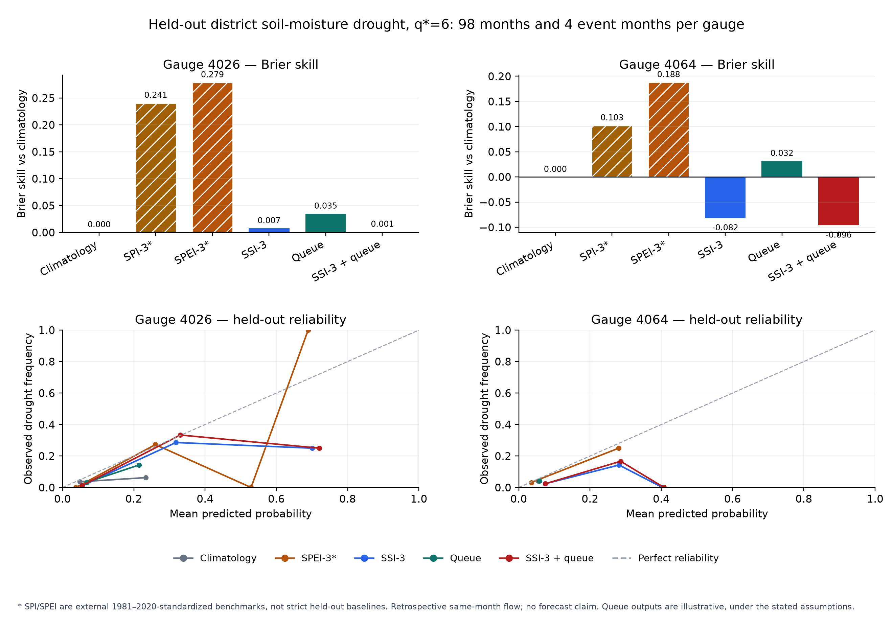

# Real-data queue-indicator comparison — results (v1, SUPERSEDED)

> **Superseded 26 November 2026.** This document describes the audited-defective
> v1 two-gauge pilot, which mixed units, sat in a guaranteed-null utilisation
> regime, and had almost no held-out events. It is retained for provenance only.
> The current results are in `RESULTS_v2.md`. Do not cite any number below as a
> v2 result.

Date: 25 November 2026. Generated by `src/P02/real_data_comparison.py` from the locked protocol; no test-year tuning was performed. The SMA target uses the product's external 1981-2020 climatology, so the comparison is retrospectively held-out in model fitting but not strictly leakage-free in target construction.

## Decision

Neither gauge meets the predeclared rule: adding queue probability to SSI does not lower nominally held-out Brier score for SMA drought at q*=6. The null/negative result is retained; no superiority claim may be made.

The confirmatory rule is narrow: at q*=6, SSI+queue must have lower nominally held-out Brier score than SSI alone. The two gauges are co-primary and overall support requires improvement in both. AUC, calibration, q*=4/8 and published SPI/SPEI comparisons are secondary or exploratory.

## Source-data audit

| Gauge | District | Analysis end | Source missing days | Source longest gap (days) | Imputed days | Excluded unusable days | Longest filled gap (days) | Zero entries | Zero fraction of observed |
|---:|---|---|---:|---:|---:|---:|---:|---:|
| 4026 | maharashtra-sangli | 2019-02-28 | 668 | 611 | 0 | 672 | 0 | 9710 | 0.679 |
| 4064 | karnataka-yadgir | 2019-02-28 | 677 | 661 | 16 | 672 | 2 | 4596 | 0.321 |

The analysis stops at each gauge's last usable complete month; trailing incomplete months are excluded rather than extrapolated. Only interior gaps of at most seven days were linearly interpolated and flagged day by day; a longer gap ends the usable record. Zero entries were retained as recorded; their hydrological/coding semantics remain unresolved. No rho interpretation is made for zero-flow days. CAMELS documents m3/s units and a q_zero attribute but not a station-specific zero/regulation rule.

## Target availability

| Gauge | Target | Split | Expected months | Available months | Excluded flow/incomplete | Common complete-case months | Missing target | Event months | Event fraction | Events |
|---:|---|---|---:|---:|---:|---:|---:|---:|---:|---:|
| 4026 | sma | train | 360 | 360 | 0 | 358 | 0 | 29 | 0.081 | 22 |
| 4026 | sma | test | 120 | 98 | 22 | 98 | 0 | 4 | 0.041 | 3 |
| 4064 | sma | train | 360 | 360 | 0 | 358 | 0 | 20 | 0.056 | 15 |
| 4064 | sma | test | 120 | 98 | 22 | 98 | 0 | 4 | 0.041 | 3 |

## Primary nominally held-out results: SMA drought, q*=6

| Gauge | Model | Brier | Brier skill | AUC | Log loss | Cal. intercept | Cal. slope | Event-month mean p |
|---:|---|---:|---:|---:|---:|---:|---:|---:|
| 4026 | climatology | 0.0413 | 0.0000 | 0.7872 | 0.1531 | -1.3990 | 0.5973 | 0.1750 |
| 4026 | queue | 0.0399 | 0.0347 | 0.7580 | 0.1630 | -0.0414 | 1.3414 | 0.1354 |
| 4026 | spei3 | 0.0298 | 0.2788 | 0.9787 | 0.1139 | 0.0395 | 1.7989 | 0.3932 |
| 4026 | spi3 | 0.0314 | 0.2407 | 0.9654 | 0.1256 | 0.5794 | 2.1900 | 0.3419 |
| 4026 | ssi3 | 0.0410 | 0.0074 | 0.9269 | 0.1526 | -1.1510 | 1.0777 | 0.3897 |
| 4026 | ssi3_plus_queue | 0.0413 | 0.0009 | 0.8590 | 0.1584 | -1.2926 | 0.9423 | 0.3978 |
| 4064 | climatology | 0.0409 | 0.0000 | 0.6809 | 0.1569 | -1.7572 | 0.3158 | 0.0833 |
| 4064 | queue | 0.0396 | 0.0320 | 0.7261 | 0.1656 | -0.3188 | 1.0240 | 0.0719 |
| 4064 | spei3 | 0.0332 | 0.1883 | 0.9282 | 0.1187 | 1.1410 | 1.6023 | 0.1686 |
| 4064 | spi3 | 0.0367 | 0.1025 | 0.8856 | 0.1369 | 0.7543 | 1.4526 | 0.1222 |
| 4064 | ssi3 | 0.0442 | -0.0816 | 0.8059 | 0.1793 | -0.7201 | 1.2476 | 0.2049 |
| 4064 | ssi3_plus_queue | 0.0448 | -0.0960 | 0.7979 | 0.1796 | -0.8517 | 1.1654 | 0.2040 |

Calibration intercept/slope are descriptive held-out diagnostics; ideal values are 0 and 1. Predictions were not recalibrated.



*Figure 1. Observed SMA, uncalibrated model-predicted probabilities, Brier skill and reliability. Queue alone has small Brier skill over climatology, while adding queue to SSI does not improve the primary metric. Product SMA/SPI/SPEI use an external 1981-2020 reference; the comparison is retrospective and not strictly leakage-free.*

## Incremental decision

| Gauge | ΔBrier vs SSI | ΔAUC vs SSI | Best conventional model (descriptive) | ΔBrier vs best conventional | Rule met |
|---:|---:|---:|---|---:|---|
| 4026 | 0.0003 | -0.0678 | spei3 | 0.0115 | no |
| 4064 | 0.0006 | -0.0080 | spei3 | 0.0116 | no |

Negative Brier differences are improvements. The best conventional model is selected on the test set only for description and is not a confirmatory comparator.

## Paired year-block bootstrap

| Gauge | ΔBrier (SSI+queue − SSI) | 95% interval | Bootstrap fraction improving |
|---:|---:|---|---:|
| 4026 | 0.0003 | [-0.0013, 0.0022] | 0.403 |
| 4064 | 0.0006 | [0.0001, 0.0011] | 0.009 |

## q* sensitivity: SSI+queue (exploratory)

| Gauge | q* | Brier | Brier skill | AUC | ΔBrier vs SSI | ΔAUC vs SSI | Lower Brier than SSI |
|---:|---:|---:|---:|---:|---:|---:|---|
| 4026 | 4 | 0.0411 | 0.0061 | 0.8590 | 0.0001 | -0.0678 | no |
| 4026 | 6 | 0.0413 | 0.0009 | 0.8590 | 0.0003 | -0.0678 | no |
| 4026 | 8 | 0.0414 | -0.0026 | 0.8590 | 0.0004 | -0.0678 | no |
| 4064 | 4 | 0.0444 | -0.0863 | 0.8032 | 0.0002 | -0.0027 | no |
| 4064 | 6 | 0.0448 | -0.0960 | 0.7979 | 0.0006 | -0.0080 | no |
| 4064 | 8 | 0.0450 | -0.1012 | 0.7952 | 0.0008 | -0.0106 | no |

## Missing-flow sensitivity: SSI+queue, q*=6

| Gauge | Sensitivity | Fill | Test n | Event months | Prevalence | Brier | ΔBrier vs SSI | Lower Brier than SSI |
|---:|---|---|---:|---:|---:|---:|---:|---|
| 4026 | causal_forward_fill | forward | 98 | 4 | 0.0408 | 0.0413 | 0.0003 | no |
| 4026 | exclude_imputed_months | linear | 98 | 4 | 0.0408 | 0.0413 | 0.0003 | no |
| 4064 | causal_forward_fill | forward | 98 | 4 | 0.0408 | 0.0448 | 0.0006 | no |
| 4064 | exclude_imputed_months | linear | 94 | 3 | 0.0319 | 0.0366 | 0.0006 | no |

Absolute Brier scores in the imputation-exclusion rows are not directly comparable with the full sample because gauge 4064 loses one drought month; the paired SSI+queue versus SSI difference remains the relevant sensitivity check.

## External product reference periods

The supplied SMA target and published district SPI-3/SPEI-3 use the product's 1981-2020 reference period, which overlaps the nominal test years. No test labels enter model fitting, but the target transformation itself is not strictly held-out. Raw soil-moisture/CHIRPS/ERA5 inputs needed to rebuild 1981-2010 climatologies are not available locally. SMA is therefore an external, non-strict target and SPI/SPEI are external, non-strict benchmarks; none determines the confirmatory rule.

## Event timing

The retrospective onset offset is the first uncalibrated SSI+queue predicted probability >0.5 within six months before/on observed SMA onset, using held-out predictions only. Zero means concurrent threshold exceedance. This is **not forecast lead time**.

| Gauge | Test events | Events with crossing | Median offset (months) | Range |
|---:|---:|---:|---:|---|
| 4026 | 3 | 1 | 0.0000 | 0 to 0 |
| 4064 | 3 | 0 | NA | NA |

## Interpretation limits

- Proxy-derived queue outputs are **illustrative, under the stated assumptions**.
- Demand lambda is a process scenario, not measured irrigation demand.
- District area proxies are assumptions, not gauge command areas.
- Gauge and district spatial scales differ.
- Same-month observed flow makes this retrospective diagnosis only.
- SSI and queue share observed flow; any gain may reflect richer flow information rather than queue-state information specifically.
- Supplied SMA and published SPI/SPEI use a non-strict external 1981-2020 reference period; target construction is not strictly held-out.
- Two gauges are a pilot. No population-general significance is claimed.
- Soil moisture is a land-state target, not a direct crop-loss measure.
- Zero-flow semantics and station regulation remain unresolved.

## Reproduce

```powershell
& 'C:\Users\ankit.deshmukh\AppData\Local\miniconda3\envs\drought\python.exe' src/P02/real_data_comparison.py
python src/P02/make_comparison_figure.py
```

No raw CMIP6 output is used anywhere in this comparison.
